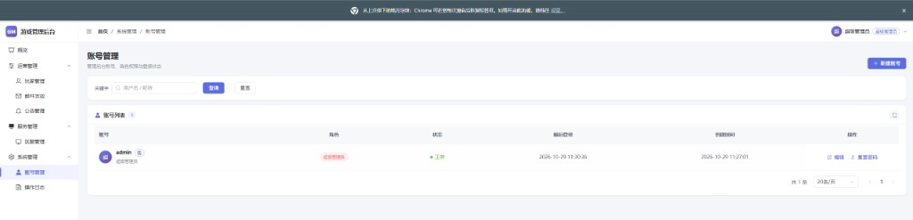

# SLG 游戏 GM 管理后台

面向 SLG 游戏的运营后台。后端 Go + Gin + MongoDB，前端 Vue 3 + Vite + TypeScript + Element Plus。
一个进程同时提供接口和页面；默认带内存模拟的游戏服，不接真实游戏服也能完整试用。



## 功能

角色从高到低：超级管理员 `super_admin` > 管理员 `admin` > 运营 `operator` > 只读 `viewer`。
接口和菜单都按角色控制，低角色看不到高角色的入口。

| 菜单 | 模块 | 能做什么 | 最低角色 |
| --- | --- | --- | --- |
| 概览 | 仪表盘 | 区服数、实时在线、今日邮件、系统状态，以及最新邮件、公告和各区服在线 | 只读 |
| 运营管理 | 玩家管理 | 按区服查询玩家、看详情；封禁 / 解封、踢下线、增减资源 | 查看：只读；操作：运营 |
| 运营管理 | 邮件发放 | 发给指定玩家，或发到一个 / 多个 / 全部区服；可带道具附件，逐服记录下发结果 | 运营 |
| 运营管理 | 公告管理 | 跑马灯公告草稿、编辑、发布到指定区服 | 运营 |
| 服务管理 | 区服管理 | 区服增删改，实时探测在线人数和是否可达 | 查看：只读；编辑：管理员 |
| 系统管理 | 账号管理 | GM 账号增删改、改角色、禁用、重置密码 | 超级管理员 |
| 系统管理 | 操作日志 | 自动记录所有写操作，密码字段脱敏，保留 180 天后自动清理 | 管理员 |

资源类型：金币 `gold`、粮食 `food`、木材 `wood`、石料 `stone`、铁矿 `iron`。增减按增量提交，扣到 0 为止。

## 环境要求

- Go 1.22+
- Node.js 20+（前端 TypeScript 固定在 5.9，`vue-tsc` 暂不支持 TypeScript 7）
- MongoDB 5+，本机已有可直接用，没有的话用下面的 Docker Compose 起一个

## 本地开发

```bash
# 1. 启动 MongoDB（本机已有可跳过）
docker compose -f deploy/docker-compose.yml up -d

# 2. 启动后端，监听 :8080
cd server
go run ./cmd/gm-server -config configs/config.yaml

# 3. 另开一个终端启动前端，监听 :5173，/api 自动代理到 :8080
cd web
npm install
npm run dev
```

也可以用根目录的 Makefile：`make mongo`、`make server`、`make web-dev`。

打开 http://localhost:5173 ，用 `admin` / `admin123` 登录。这个账号在第一次启动、库里还没有它时自动创建，登录后请马上改密码。

配置里 `game.mock` 默认为 `true`：每个新区服会在内存里生成 200 个假玩家。先在「区服管理」里加一个区服，就能试用查询、封禁、邮件、公告这些功能。

## 配置

配置文件是 `server/configs/config.yaml`，启动参数 `-config` 可改路径。

```yaml
server:
  addr: ":8080"
  mode: debug             # debug | release
  web_dist: "../web/dist" # 前端构建产物，留空则不托管页面

mongo:
  uri: "mongodb://127.0.0.1:27017"
  database: "slg_gm"

jwt:
  secret: "change-me-in-production"
  expire_hours: 24

game:
  mock: true              # false 时改为调用真实游戏服
  sign_secret: "gm-sign-secret"
  timeout_seconds: 5

admin:                    # 仅在该账号不存在时用于初始化超级管理员
  username: admin
  password: admin123
```

敏感项可以用环境变量覆盖，不必改文件：

| 环境变量 | 覆盖的配置 |
| --- | --- |
| `GM_SERVER_ADDR` | `server.addr` |
| `GM_MONGO_URI` | `mongo.uri` |
| `GM_MONGO_DB` | `mongo.database` |
| `GM_JWT_SECRET` | `jwt.secret` |
| `GM_GAME_SIGN_KEY` | `game.sign_secret` |

上线前改掉 `jwt.secret` 和 `game.sign_secret`，把 `game.mock` 设为 `false`，`server.mode` 设为 `release`。

## 生产部署

```bash
make build
# 等价于：
#   cd web && npm run build          产物在 web/dist
#   cd server && go build -o bin/gm-server ./cmd/gm-server
```

`server.web_dist` 指向 `web/dist` 时，后端会托管前端：存在的静态文件直接返回，其余路径回退到 `index.html`。所以线上只需要跑 `gm-server` 这一个进程，浏览器访问后端地址即可。

## 目录结构

请求从路由进来，经过中间件，到处理器，再到业务层，最后落到数据层或游戏服客户端：

`router → middleware → handler → service → repository / gameclient`

```
slg_game_gm/
├── deploy/docker-compose.yml    本地 MongoDB
├── Makefile
├── server/
│   ├── cmd/gm-server/           程序入口，读取配置并监听退出信号
│   ├── configs/config.yaml
│   ├── internal/
│   │   ├── app/                 组装依赖、启动、优雅退出
│   │   ├── config/              配置加载和环境变量覆盖
│   │   ├── database/            MongoDB 连接
│   │   ├── model/               文档结构：账号、区服、邮件、公告、操作日志
│   │   ├── repository/          数据访问和索引，启动时自动创建
│   │   ├── service/             业务逻辑
│   │   ├── handler/             HTTP 处理：参数绑定和响应
│   │   ├── dto/                 请求、响应结构
│   │   ├── middleware/          JWT 鉴权、角色校验、操作日志、访问日志、CORS
│   │   ├── router/              路由注册，以及前端页面托管
│   │   └── gameclient/          调游戏服：HTTP 签名实现，外加内存 Mock
│   └── pkg/                     errcode、统一响应、JWT
└── web/src/
    ├── api/                     axios 封装、接口和类型
    ├── stores/                  登录用户、区服列表缓存
    ├── router/                  路由、菜单分组（meta.group）、权限守卫
    ├── layout/                  侧边栏和顶栏
    ├── views/                   各页面
    ├── composables/             分页表格
    └── utils/                   时间、数字、角色和状态的展示
```

MongoDB 集合：`admin_users`、`game_servers`、`mails`、`announcements`、`operation_logs`。
用户名和区服号有唯一索引；操作日志按 `created_at` 建了 180 天的 TTL 索引。

接口统一返回 `{"code": 0, "msg": "ok", "data": ...}`，`code` 为 0 表示成功，分页数据在 `data.list` 和 `data.total`。
业务错误码定义在 `server/pkg/errcode/errcode.go`。

## 游戏服 GM 接口约定

`game.mock` 为 `false` 时，后端按区服配置的 `gm_addr` 发请求：

- `POST {gm_addr}/gm/{cmd}`，body 为 JSON
- 请求头 `X-GM-Timestamp` 是 Unix 秒；`X-GM-Sign` 是 `hex(HMAC-SHA256(sign_secret, timestamp 的字节 + body 的字节))`
- 响应 `{"code": 0, "msg": "", "data": ...}`。`code` 为 `404` 表示玩家不存在，其他非 0 值视为业务失败
- 游戏服应校验签名，并拒绝时间戳偏差过大的请求，避免重放

| cmd | 请求体 | data |
| --- | --- | --- |
| `status` | `{}` | `{"server_id": 区服号, "online": 在线人数, "registered": 注册人数}` |
| `player/search` | `{"keyword": "昵称或玩家ID"}` | `Player[]`，建议最多返回 100 条 |
| `player/get` | `{"player_id": 1001000001}` | `Player` |
| `player/ban` | `{"player_id", "until", "reason"}`，`until` 省略表示永久封禁 | 无 |
| `player/unban` | `{"player_id"}` | 无 |
| `player/kick` | `{"player_id"}` | 无 |
| `player/resources` | `{"player_id", "changes": {"gold": 1000, "food": -500}}` | 无，按增量修改 |
| `mail/send` | `{"player_ids", "title", "content", "attachments", "expire_days"}`，`player_ids` 为空表示全服 | 无 |
| `announcement/push` | `{"id", "title", "content", "start_at", "end_at", "interval_minutes"}` | 无 |

`Player` 的字段在 `server/internal/gameclient/client.go`。时间一律用 RFC3339。
发给多个区服时是并发调用的，某个区服失败不会影响其他区服，结果记在邮件或公告的 `results` 里。

## 加一个新功能

以「礼包码」为例，按层往下补：

1. `server/internal/model` 定义文档。
2. `repository` 增加集合和索引，并在 `app.go` 里调用 `EnsureIndexes`。
3. `service` 写业务，`dto` 定义请求。
4. `handler` 做参数绑定和响应。
5. `router` 注册路由，用 `middleware.RequireRole` 限制角色。
6. 前端在 `api/index.ts` 加接口，`views/` 加页面，再在 `router/index.ts` 的 `menuRoutes` 里加一项。
   填了 `meta.group` 就会进对应的侧边栏分组，填了 `meta.role` 就只有达到该角色的账号能看到。
